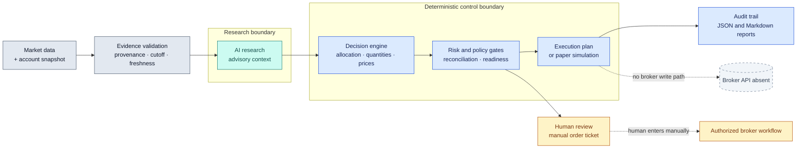

<div align="center">
  
  <h1>Meridian Alpha</h1>
  <p><strong>AI-Assisted Portfolio Decision Intelligence</strong></p>
  <p>Evidence-driven market research. Deterministic risk controls. Human-authorized decisions.</p>

  <p>
    <a href="https://github.com/SiriZhao/meridian-alpha/actions/workflows/ci.yml"></a>
    <a href="https://www.python.org/downloads/release/python-3120/"></a>
    <a href="#safety-model"></a>
    <a href="https://modelcontextprotocol.io/"></a>
  </p>
</div>

> **Meridian Alpha is decision-support software, not a trading bot.** Research can inform a review; it cannot authorize an order, choose executable size or price, or imply a fill.

<p align="center"><a href="#overview">Overview</a> · <a href="#architecture">Architecture</a> · <a href="#capabilities">Capabilities</a> · <a href="#quick-start">Quick start</a> · <a href="#workflow">Workflow</a> · <a href="#safety-model">Safety model</a> · <a href="#documentation">Documentation</a> · <a href="#contributing">Contributing</a></p>

## Overview

Meridian Alpha is a Python 3.12 system for evidence-grounded US-equity research and manual portfolio decision support. It turns timestamped market and account inputs into a structured, auditable decision record and, where every gate permits, a paper-only execution plan.

The central design choice is to keep probabilistic research outside the control plane. AI may summarize evidence, surface risks, compare scenarios, and identify unknowns. Project-owned deterministic code controls allocation, quantities, limit prices, reconciliation, risk gates, readiness, and paper-ledger accounting.

Meridian is independent from Alpha Mosaic and Personal Alpha Terminal. It does not share their runtime state, account semantics, or migration path.

### Why this boundary exists

LLM output can be useful and still be stale, incomplete, or wrong. A model response is therefore treated as advisory evidence with provenance and a cutoff, never as an executable instruction. Missing, conflicting, or stale data remains explicit and fails closed; it is not filled with invented prices, bars, returns, or portfolio facts.

**The useful distinction:** Meridian makes the reasoning inspectable and the control decisions deterministic, while leaving the final real-world action with a human.

## Capabilities

| Area | Maturity | What is actually in the repository |
| --- | --- | --- |
| Market evidence | **IMPLEMENTED / VERIFIED** | Provider-neutral observations, timestamps, source provenance, cutoffs, freshness checks, identity checks, and explicit unavailable states. |
| Structured AI research | **IMPLEMENTED / BLOCKED** | GPT/Codex advisory research can be schema-validated and bound to a job, market snapshot, universe, evidence IDs, and model provenance. Production acceptance remains evidence-gated. |
| Deterministic decisions | **IMPLEMENTED / VERIFIED** | Allocation, reconciliation, portfolio constraints, quantities, limit-price policy, and readiness are owned by Meridian code. |
| Paper ledger | **IMPLEMENTED / VERIFIED** | `Schwab-Paper` is a local SQLite paper account with atomic updates, same-account/day idempotency, reports, and simulated fills only. |
| Audit and reports | **IMPLEMENTED / VERIFIED** | JSON and Markdown reports expose `DATA`, `RESEARCH`, `DECISION`, `RISK`, `PAPER`, and `HOST_LLM` dimensions plus blockers and next actions. |
| CLI / PowerShell / Skill / MCP | **IMPLEMENTED / VERIFIED** | One application service is shared by the CLI, Windows launcher, Skill workflow, and MCP Host-envelope delegation. The MCP research surface is read-only and no MCP tool exposes broker writes. |
| TradingAgents adapter | **OPTIONAL / EXPERIMENTAL** | Legacy research adapter, lazy and disabled by default; not a base dependency or canonical decision path. |
| FinRL-X | **OPTIONAL / BLOCKED** | Isolated challenger boundary exists, but no validated FinRL-X runtime or model artifact is shipped; unavailable is represented explicitly. |
| Live broker integration | **BLOCKED / NOT IMPLEMENTED** | No broker login, broker SDK, order submission, automatic execution, or live-fill surface exists. |
| Forward evidence | **EXPERIMENTAL / SHADOW-ONLY** | Append-only, cutoff-bound evaluation records; they cannot change allocation, risk, paper-fill eligibility, or promote a strategy automatically. |

## Architecture



`MeridianApplicationService` is the canonical orchestration owner. The CLI, PowerShell launcher, Skill, and MCP Host-envelope path delegate to it; renderers only display the returned result. The paper sink is an optional terminal in the same application path, never a broker adapter.

Every daily run carries an explicit analysis cutoff. A Host research job records its job ID, market snapshot ID, quote timestamps, evidence IDs, symbol universe, and model/runtime provenance. A resumed result is accepted only when the references match exactly or a bounded price-only revalidation is recorded; otherwise the result is refreshed or blocked.

## Quick start

The repository targets Python **3.12** (`>=3.12,<3.13`). The base install does not require broker credentials or a live account. `uv` is used by CI and is pinned there to `0.12.7`; a regular virtual environment and pip are also supported.

### Install from a fresh clone

```powershell
git clone https://github.com/SiriZhao/meridian-alpha.git
Set-Location meridian-alpha
py -3.12 -m venv .venv
.\.venv\Scripts\python.exe -m pip install -e ".[dev]"
.\.venv\Scripts\python.exe -m pip check
```

For a lockfile-based setup, install `uv` and run:

```powershell
python -m pip install uv==0.12.7
python -m uv sync --frozen --group dev
```

On Linux, use `python3.12`, `.venv/bin/python`, and `.venv/bin/meridian`. The project launcher always selects the checkout's `.venv` Python on Windows.

### Readiness checks

```powershell
.\.venv\Scripts\python.exe -m meridian version --json
.\.venv\Scripts\python.exe -m meridian paths --json
.\.venv\Scripts\python.exe -m meridian doctor --json
```

`MERIDIAN_HOME` may point to an absolute writable user directory. Runtime state defaults to `%LOCALAPPDATA%\MeridianAlpha` on Windows. `doctor` performs runtime write probes; use a disposable local runtime for development, and use the approved host boundary for the canonical runtime. Do not place credentials, account numbers, or raw account snapshots in Git or configuration.

For an offline, disposable demonstration that does not touch the canonical runtime, use the repository's isolated acceptance harness:

```powershell
.\.venv\Scripts\python.exe scripts/safe_acceptance.py
```

The harness uses synthetic inputs and is useful for wiring checks only; it does not prove live market freshness, live GPT availability, profitability, or broker readiness.

## Workflow

### A research-only daily run

Provide a newly authorized, sanitized `HostAccountSnapshotEnvelope` and an optional machine-readable market fixture for offline regression:

```powershell
.\.venv\Scripts\python.exe -m meridian snapshot validate .\schemas\examples\real-host-envelope-template.json --json
.\.venv\Scripts\python.exe -m meridian daily --snapshot .\path\to\fresh-sanitized-snapshot.json --json
```

The daily path validates account identity and freshness, collects public market observations, performs deterministic analysis, optionally runs the configured advisory research stage, persists sanitized audit metadata, and emits JSON/Markdown reports. A missing or stale input produces a diagnostic or blocked result; it never becomes an invented recommendation.

### Schwab-Paper inspection

The persistent `Schwab-Paper` account is a local paper ledger, not a Schwab connection. These commands are read-only inspection commands:

```powershell
.\scripts\run_meridian.ps1 paper status --account Schwab-Paper --json
.\scripts\run_meridian.ps1 paper history --account Schwab-Paper --json
.\scripts\run_meridian.ps1 paper trades --account Schwab-Paper --json
.\scripts\run_meridian.ps1 forward-status --json
```

The canonical daily paper command is intentionally documented separately because it writes the configured runtime and requires the approved host boundary:

```powershell
.\scripts\run_meridian.ps1 doctor --json
.\scripts\run_meridian.ps1 paper run --account Schwab-Paper --json
```

Run those only through the approved host execution mechanism described in [the canonical workflow](docs/canonical-production-workflow.md). Never use a restricted sandbox as a fallback, force a historical trading date, or recreate an existing canonical day.

### Status vocabulary

Reports keep independent dimensions visible rather than collapsing them into one pass/fail value:

```text
DATA → RESEARCH → DECISION → RISK → PAPER
                    └──────── HOST_LLM (advisory runtime)
```

Typical outcomes include `PAPER_NO_TRADE`, `PAPER_BLOCKED`, `PAPER_ALREADY_EXECUTED`, `BLOCKED_STALE_MARKET`, `RESEARCH_REFRESH_REQUIRED`, and `MODEL_UNAVAILABLE`. A blocked result is a fail-closed operating result, not a fill and not proof of a live account state.

## AI research and decision governance

The research layer may perform primary analysis, skepticism, scenario construction, synthesis, and evidence-gap planning. It must classify substantive claims as facts, inferences, forecasts, or unknowns and cite the evidence IDs or source URLs that support them.

The deterministic layer then decides whether the evidence is usable. It owns:

- candidate limits and quantitative calculations;
- portfolio weights, whole-share quantities, and limit-price policy;
- cash, concentration, turnover, reconciliation, and risk constraints;
- manual-readiness certificates and paper-fill eligibility; and
- ledger mutations, idempotency, and report projections.

Schema validation does not make a response true. It checks shape, references, timestamps, cutoff chronology, and consistency. Provider attempts, source conflicts, freshness failures, and missing data remain inspectable in the report. Public research quotes stay `PUBLIC_RESEARCH_QUOTE`; execution quote certification remains blocked.

## Sanitized output shape

This is a representative **synthetic fixture shape**, not a market result or performance claim:

```json
{
  "status": "PAPER_BLOCKED",
  "status_dimensions": {
    "DATA": "BLOCKED",
    "RESEARCH": "NOT_RUN",
    "DECISION": "BLOCKED",
    "RISK": "NOT_RUN",
    "PAPER": "BLOCKED",
    "HOST_LLM": "NOT_RUN"
  },
  "recommendation_readiness": "BLOCKED",
  "manual_authority": "BLOCKED",
  "quote_certification": "BLOCKED",
  "orders": [],
  "fills": [],
  "blockers": ["BLOCKED_STALE_MARKET"],
  "execution_authority": "NONE"
}
```

The real schema contracts live in [`schemas/`](schemas/) and the canonical projections are described in [the architecture record](docs/architecture.md).

## Safety model

| Boundary | Repository contract |
| --- | --- |
| `PAPER_ONLY` | The shipped operational account is `Schwab-Paper`, a local SQLite ledger for simulation. |
| `AUTO_EXECUTION = FALSE` | No automatic broker action is available. Human review is required for every real order. |
| Research authority | AI commentary cannot set quantity, price, risk limits, ledger state, or broker authority. |
| Fill semantics | Recommendations and paper fills never imply a live fill. Only a later, newly supplied account snapshot can establish changed real account state. |
| Freshness | Stale, missing, conflicting, or uncertified market/account evidence blocks dependent outputs. |
| Data protection | Raw account snapshots, credentials, tokens, and private logs are not persisted by default and must not be committed. |

Meridian has no Schwab Trading API integration, broker login, order route, cancellation route, or fill API. HSBC holdings and credentials are outside this system.

## Repository structure

```text
src/meridian/   domain contracts, orchestration, research, decision, paper, reports
scripts/         Windows launcher, validation, packaging, and bounded diagnostics
policies/        data, allocation, model, risk, execution, paper, and universe policy
schemas/         JSON contracts and sanitized examples
skills/          packaged Meridian Skill and its references/scripts
docs/            architecture records, operating procedures, ADRs, and audit evidence
tests/           offline unit, integration, regression, and safety coverage
```

`policies/` and `schemas/` are packaged into the wheel. The mutable database, cache, reports, logs, and runs belong under `RuntimePaths`, outside the source tree.

## Development and validation

The cross-platform validation entrypoint is:

```powershell
.\.venv\Scripts\python.exe scripts/validate_repo.py
```

It runs dependency checks, Ruff, Pyright, the offline pytest suite, CLI help smoke checks, and isolated safe acceptance. The individual commands are:

```powershell
.\.venv\Scripts\python.exe -m pytest
.\.venv\Scripts\python.exe -m ruff check .
.\.venv\Scripts\pyright.exe
```

CI runs this validation on Ubuntu and Windows with Python 3.12, then exercises manual-authority and replay-integrity regressions, Skill packaging, and high-risk credential scanning. A workflow badge indicates that CI is configured; it is not a permanent claim about every commit.

## Documentation

- [Architecture and system boundaries](docs/architecture.md)
- [Canonical production workflow](docs/canonical-production-workflow.md)
- [Schwab-Paper operations](docs/schwab-paper.md)
- [Development guide](DEVELOPMENT.md)
- [Security policy](SECURITY.md)
- [Maintenance backlog](MAINTENANCE.md)
- [Forward Evidence Factory](docs/forward-evidence.md)
- [Architecture decision records](docs/adr/)

The repository currently has no `LICENSE` file. It should not be treated as openly licensed until the owner adds and publishes an explicit license.

## Roadmap

The project deliberately keeps proposed work separate from shipped behavior. Current documented directions include:

- reviewed, receipt-qualified financial evidence and broader calendar/action coverage;
- a sealed comparison dataset for native research ablations;
- measured provider, research, ledger, and publication soak telemetry;
- continued shadow evaluation with predeclared horizons and costs; and
- any future FinRL-X or TradingAgents experiment only behind an isolated, pinned, human-reviewed adapter.

None of these items enables broker execution, changes risk limits, or promotes a strategy automatically. See [MAINTENANCE.md](MAINTENANCE.md) for the maintained backlog and its evidence limits.

## Contributing

Read [DEVELOPMENT.md](DEVELOPMENT.md), [SECURITY.md](SECURITY.md), and the relevant ADR before changing an interface or boundary. Preserve the project-owned protocols, fail-closed states, timestamp provenance, paper/live separation, and manual approval boundary. Do not commit runtime databases, reports containing private inputs, credentials, or generated caches.

Please report suspected security issues privately to the repository owner rather than opening a public issue containing sensitive data. There is no public license yet; contribution and redistribution terms remain owner-controlled until one is added.

---

Meridian Alpha is research infrastructure for careful decisions. It does not promise returns, production trading readiness, or live-broker integration.
